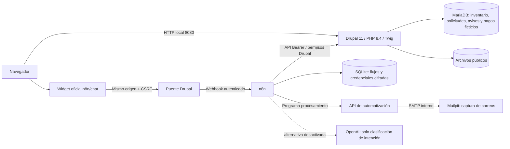

# Arquitectura del prototipo

Solo `drupal/web` es público. Composer y `vendor` quedan fuera del DocumentRoot. Las credenciales provienen de `.env`, excluido de Git y del contexto Docker. El usuario de servicio de n8n carece de permisos del panel hotelero. Los visitantes consultan una solicitud solo con código y clave privada; nunca obtienen listados de clientes.

MariaDB es la fuente de verdad del negocio simulado. Un bloqueo InnoDB serializa las escrituras de habitaciones, reservas y pagos ficticios. El intervalo de ocupación es `[ingreso, salida)`. No hay cobros reales ni confirmaciones del establecimiento real.

Las interfaces se enlazan solo a localhost. Los contenedores se comunican por su red interna. El widget utiliza el mismo origen de Drupal, sin CORS global. Las notificaciones se capturan en un servidor SMTP de prueba; no salen al correo de personas reales. El transporte SMTP está fijado a Mailpit en la implementación de demostración.

La alternativa de IA no determina precios, fechas, disponibilidad ni estados: solo clasifica una intención, y Drupal produce la respuesta desde la base. Por defecto no se invoca ningún proveedor de IA.
