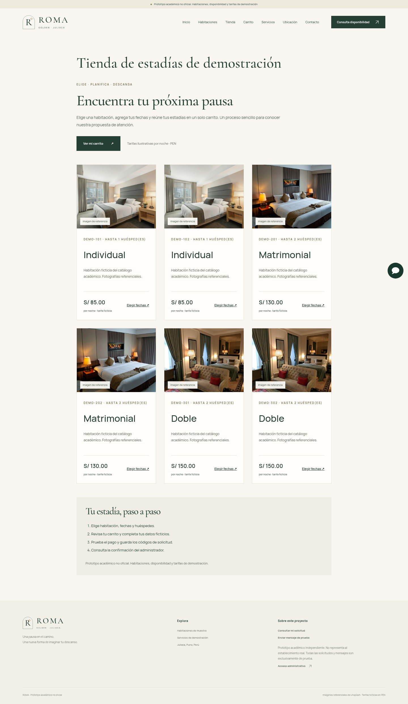
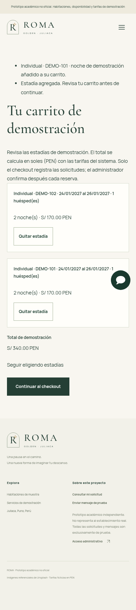

# Guía rápida de la tienda y reservas de demostración

**Proyecto:** Golden Roma · prototipo académico independiente. **Versión:** 1.1, 10/11/2026. **Autores:** Dimas Mijael Flores Yerba y Jords Williams Calla Mamani, Universidad Nacional de Juliaca.

Esta guía está dirigida al visitante y al administrador de la demostración. Usa únicamente nombres y correos ficticios. Los precios y los pagos son de prueba. Necesitas la aplicación iniciada y un navegador; el administrador necesita su cuenta asignada.

## Elegir una estadía

1. Abre [la tienda local](http://localhost:8080/tienda).
2. Pulsa **Elegir fechas** en una habitación.
3. Selecciona **Llegada**.
4. Selecciona **Salida**, posterior a la llegada.
5. Indica **Huéspedes en esta habitación**, dentro de su capacidad.
6. Pulsa **Agregar al carrito**.

**Resultado:** verás la estadía, sus fechas, huéspedes, noches e importe ficticio. Todavía no se registra una reserva. Para agregar otra habitación, usa **Seguir eligiendo estadías**.

## Revisar o quitar una estadía

1. Abre **Carrito** desde la navegación.
2. Revisa las fechas, los huéspedes y el total de cada estadía.
3. Pulsa **Quitar estadía** si deseas eliminar una línea.

**Resultado:** el carrito muestra las líneas restantes y actualiza el total. Para modificar fechas, quita esa estadía y agrégala nuevamente. En móvil, abre el menú mediante el botón de tres líneas.

## Completar tus datos y revisar el pedido

1. Pulsa **Continuar al checkout** en el carrito.
2. Completa **Nombre completo**.
3. Completa **Correo electrónico**.
4. Deja vacío **Teléfono (opcional)** o escribe un número ficticio válido.
5. Marca **Utilizo datos ficticios y entiendo que el pedido y el pago son de demostración**.
6. Pulsa **Revisar pedido**.
7. Pulsa **Elegir pago de prueba** después de revisar el resumen.

**Resultado:** aparecerán las opciones del pago de demostración. Si un campo es inválido, verás su explicación junto al campo y conservarás los datos ingresados.

## Probar el pago y guardar tus códigos

1. Selecciona **Aprobar pago de prueba**.
2. Pulsa **Registrar pedido de prueba**.
3. Guarda el **Código de solicitud** de cada habitación en un lugar privado.
4. Guarda su **Clave privada de consulta** junto al código correspondiente.

**Resultado:** aparecerá **Pedido de demostración registrado**. Las solicitudes estarán pendientes de confirmación administrativa. No se habrá cobrado dinero.

Para ensayar otros resultados, selecciona **Rechazar pago de prueba** o **Cancelar operación de prueba** antes de enviar. Verás el aviso correspondiente; el carrito se conserva y no se registran reservas. Puedes volver al carrito o elegir aprobar después.

## Consultar una solicitud

1. Abre **Consultar mis solicitudes con código y clave** desde el recibo.
2. Introduce el código de una solicitud.
3. Introduce su clave privada.
4. Envía el formulario de consulta.

**Resultado:** verás el estado vigente de esa solicitud. Consulta cada habitación con su propio código. El chatbot orienta, pero no solicita tus claves privadas ni confirma habitaciones.

## Confirmar o cancelar como administrador

1. Accede con la cuenta administrativa mediante **Acceso administrativo**, al pie de página.
2. Abre **Reservas** en el panel hotelero.
3. Localiza el código de la solicitud de prueba.
4. Pulsa **Confirmar** o **Cancelar**.
5. Confirma la acción en la pantalla siguiente.
6. Abre **Pedidos de la tienda** después de la siguiente ejecución de n8n, programada cada minuto.

**Resultado:** cada reserva refleja la decisión. Si todas las reservas del pedido se confirman, el pedido muestra la confirmación; si todas se cancelan, muestra la cancelación. Las decisiones mixtas requieren revisar las solicitudes individuales.

## Pedir ayuda al asistente

1. Abre el botón flotante del chat.
2. Escribe una pregunta, por ejemplo **¿Cómo uso el carrito de la tienda?**.
3. Lee la respuesta y utiliza el enlace correspondiente.

**Resultado:** recibirás orientación del flujo n8n conectado al sistema. Para consultar disponibilidad, incluye llegada, salida y número de personas. Los mensajes de prueba se pueden revisar en la [bandeja local](http://localhost:8025).

## Resolver problemas

| Síntoma | Causa probable | Qué hacer |
| --- | --- | --- |
| El teléfono no admite letras | Se escribieron letras en el campo opcional | Déjalo vacío o usa números y separadores permitidos. |
| La habitación ya está en tu carrito | Hay dos líneas superpuestas para la misma habitación | Quita la anterior o elige otra habitación. |
| Una habitación dejó de estar disponible | Cambió la disponibilidad antes de finalizar | Vuelve al carrito y elige otra habitación o fechas. |
| La tarifa o cantidad cambió | El precio se actualizó durante el proceso | Vuelve al carrito y revisa el total antes de continuar. |
| La sesión no es válida | El formulario está vencido o pertenece a otra sesión | Recarga la página y vuelve a enviarlo. |
| Se alcanzó el límite de intentos | Se hicieron muchos envíos seguidos | Espera 15 minutos antes de volver a intentar. |
| El pedido está pendiente tras aprobar el pago de prueba | Falta la decisión administrativa | Confirma cada solicitud desde el panel autorizado. |

**Glosario:** el *carrito* agrupa estadías; el *checkout* es el proceso para registrar el pedido; el *pedido* reúne solicitudes; una *solicitud pendiente* espera al administrador; el *pago de prueba* ensaya un resultado sin dinero real.

**Fuentes de la guía:** pantallas, textos del módulo de tienda y pruebas de navegador del repositorio. Las capturas del catálogo y del carrito acompañan el documento; se omite la captura del recibo para conservar privadas sus claves. No quedan funciones de esta guía por confirmar; la pasarela bancaria externa queda fuera de la demostración local.
