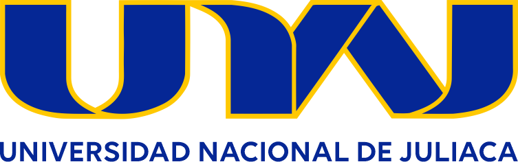

UNIVERSIDAD NACIONAL DE JULIACA
FACULTAD DE CIENCIAS DE INGENIERÍAS
ESCUELA PROFESIONAL DE INGENIERÍA DE SOFTWARE Y SISTEMAS

# Propuesta de un sistema web de reservas con chatbot y n8n para el Hotel Golden Roma

Autores:
Dimas Mijael Flores Yerba
Jords Williams Calla Mamani

Juliaca, 10 de noviembre de 2026

## 1. Presentación de la propuesta

Se propone al Hotel Golden Roma una página web de reservas con un chatbot: un asistente virtual que conversa con los visitantes y los orienta. Con n8n se conectarán consultas, solicitudes y avisos para reducir tareas manuales. El cliente podrá consultar desde su celular y el personal gestionará las solicitudes en un panel.

El proyecto académico de la Universidad Nacional de Juliaca se adaptará a las necesidades del hotel. Se propone empezar con una demostración y un piloto supervisado para que la administración evalúe su utilidad antes de adoptarlo.

## 2. Justificación

Un visitante necesita encontrar con facilidad qué ofrece un hotel, cuánto costaría su estadía y cómo solicitar una reserva. Para el personal, resulta útil reunir las solicitudes en un solo lugar y revisar las fechas con claridad. Una herramienta digital bien utilizada puede facilitar ambas tareas y fortalecer la presentación del negocio.

## 3. Objetivos

Objetivo general. Desarrollar y evaluar para el Hotel Golden Roma un sistema de reservas web con chatbot y n8n, que ayude a organizar solicitudes, responder consultas frecuentes y mejorar la atención al huésped.

Objetivos específicos:

- Presentar las habitaciones, tarifas y servicios del Hotel Golden Roma con información aprobada por su administración.

- Organizar las solicitudes y permitir su confirmación, cancelación y consulta de estado.

- Comprobar fechas y capacidad para reducir errores al asignar habitaciones.

- Integrar un chatbot con n8n para consultas, avisos y recordatorios, y evaluar su utilidad en un piloto.

## 4. Beneficios esperados para el Hotel Golden Roma

La web presentará la oferta del Hotel Golden Roma, el chatbot orientará al visitante y n8n conectará las tareas de atención. Los beneficios previstos combinan funciones ya desarrolladas y automatizaciones que se integrarán y evaluarán durante el piloto.

| Beneficio | ¿Cómo puede ayudar al establecimiento? |
| --- | --- |

| 1. Mayor presencia digital | Ofrece un espacio propio para presentar el hotel y facilita que los visitantes conozcan su oferta. |

| 2. Acceso desde el celular | Permite revisar habitaciones y enviar solicitudes sin depender de una computadora. |

| 3. Chatbot para consultas frecuentes | El asistente virtual podrá explicar habitaciones, servicios y tarifas con datos del sistema, incluso fuera del horario de atención. |

| 4. Menos trabajo repetitivo | n8n permitirá enlazar tareas: recibir solicitudes, avisar al personal y enviar mensajes según reglas aprobadas. |

| 5. Solicitudes mejor organizadas | Cada envío quedará registrado; n8n podrá generar un aviso para facilitar su revisión por el personal. |

| 6. Menor riesgo de errores | Comprueba fechas y capacidad antes de confirmar, para evitar asignaciones incompatibles. |

| 7. Precios más comprensibles | Muestra un importe estimado según las fechas elegidas y las tarifas registradas. |

| 8. Seguimiento oportuno | El cliente consultará su solicitud y n8n podrá avisarle cuando el hotel la confirme o cancele. |

| 9. Control para la administración | El personal autorizado puede actualizar habitaciones, tarifas y servicios desde el mismo entorno. |

| 10. Reportes programados | n8n podrá preparar resúmenes de solicitudes y ocupación para apoyar la planificación y revisión diaria. |

| 11. Recordatorios oportunos | Podrán programarse avisos previos a la llegada, respetando el estado de la reserva y los canales acordados. |

| 12. Integraciones por etapas | Los flujos podrán ampliarse a correo o pasarelas de pago, una vez configurados y probados los servicios. |

Una presentación profesional puede generar confianza y favorecer nuevas consultas. La propuesta busca convertir ese interés en solicitudes que el hotel pueda atender y gestionar con mayor orden. El aumento de ventas deberá evaluarse con datos de uso; no se presenta como un resultado garantizado.

## 5. Chatbot y automatización con n8n

El chatbot será la puerta de atención digital: podrá responder sobre habitaciones, servicios y tarifas, consultar disponibilidad y guiar la solicitud de reserva. Obtendrá sus respuestas del sistema del hotel. n8n conectará estas consultas con los procesos internos; el personal autorizado conservará la decisión sobre las confirmaciones y los casos especiales.

Ejemplo: un visitante pregunta por una habitación; el chatbot consulta los datos y lo guía para solicitarla. La web registra el pedido pendiente y n8n avisa al personal. Tras la confirmación del hotel, otro flujo informa al cliente.

La web, el panel y las reservas ya se probaron con datos de demostración. El chatbot y los flujos de n8n siguen pendientes de integración y validación. No se realizan cobros.

## 6. Plan piloto propuesto

Se propone una evaluación de cuatro semanas, ajustable a la disponibilidad del hotel, con participación de la administración.

| Etapa | Actividad principal |
| --- | --- |

| Semana 1: diagnóstico | Revisar la atención actual, acordar contenidos y seleccionar las tareas que se automatizarán. |

| Semana 2: integración | Configurar habitaciones, chatbot y flujos de n8n; capacitar al personal y probar avisos. |

| Semana 3: piloto supervisado | Realizar solicitudes controladas y evaluar respuestas, notificaciones y seguimiento. |

| Semana 4: evaluación | Comparar tiempos, revisar incidencias y acordar mejoras con la administración. |

## 7. Metas y evaluación de resultados

- Dar seguimiento a todas las solicitudes del piloto y comprobar el envío de los avisos configurados.

- Evitar confirmaciones incompatibles y verificar que el chatbot responda con datos del sistema.

- Comparar tiempos de atención y tareas manuales antes y después, y recoger la valoración del personal.

Las metas, responsables, canales de comunicación, soporte y costos se acordarán antes de una operación comercial.

## 8. Solicitud de evaluación y colaboración

Solicitamos al Hotel Golden Roma una oportunidad para presentar la demostración y acordar un piloto supervisado. Aportaremos desarrollo, pruebas y capacitación. La administración validará contenidos y resultados antes de decidir la adopción, conservando el control de sus operaciones.

## Referencias técnicas

Drupal. (s. f.). Introduction to Form API. https://www.drupal.org/docs/drupal-apis/form-api/introduction-to-form-api

n8n. (s. f.). Understand workflows. https://docs.n8n.io/workflows/
