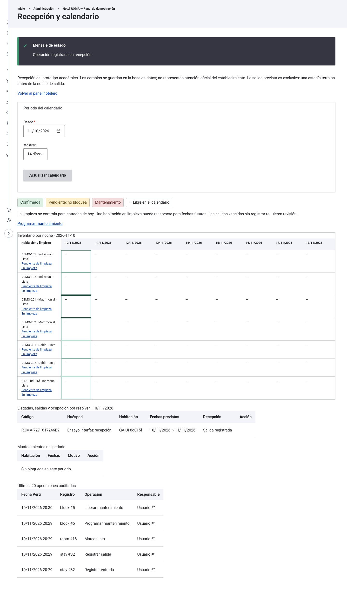

# Guía de recepción y calendario

Dirigida al administrador y al responsable hotelero del prototipo académico. Usa únicamente huéspedes ficticios. Necesitas iniciar sesión y tener permiso de gestión de recepción. La información no representa la operación oficial del hospedaje.

## Consultar habitaciones por fecha

1. Abre **Recepción y calendario** desde el panel hotelero.
2. Selecciona **Desde**.
3. Selecciona **Mostrar**: 7, 14 o 31 días.
4. Pulsa **Actualizar calendario**.

**Resultado:** verás una fila por habitación y una columna por noche. En verde aparecen confirmadas, en amarillo solicitudes pendientes y en rojo mantenimiento. Las pendientes no bloquean. En móvil puedes desplazar horizontalmente el calendario. Las habitaciones inactivas conservan su historial y no admiten nuevas solicitudes.

## Registrar una entrada

La solicitud debe estar confirmada, la llegada prevista debe haber ocurrido y la salida prevista debe ser posterior a hoy. La habitación debe estar activa, lista, sin mantenimiento ni otra entrada pendiente de salida.

1. Abre **Recepción y calendario**.
2. Busca la reserva en **Llegadas, salidas y ocupación por resolver**.
3. Pulsa **Registrar entrada**.
4. Revisa el registro que aparece en la confirmación.
5. Pulsa **Confirmar operación**.

**Resultado:** la estadía pasa a **Hospedado** y se guarda la hora de entrada y el usuario responsable. Repetir la misma entrada no crea eventos duplicados. La entrada no cobra dinero ni emite boletas o facturas.

## Registrar una salida

La estadía debe tener una entrada registrada. La salida conserva el historial comercial y el importe estimado original: no calcula devoluciones ni altera pagos.

1. Busca la estadía **Hospedado** en recepción.
2. Pulsa **Registrar salida**.
3. Pulsa **Confirmar operación**.

**Resultado:** verás **Salida registrada** y la habitación quedará **Pendiente de limpieza**. Una salida anticipada libera las noches restantes; para recibir huéspedes hoy también debes marcar la habitación lista. No canceles una reserva con entrada o salida registrada para modificar su historial.

## Preparar una habitación

No puedes cambiar su limpieza mientras tenga una entrada sin salida. La limpieza de hoy restringe entradas para hoy; no impide solicitudes para fechas futuras.

1. Localiza la habitación en la primera columna del calendario.
2. Pulsa **En limpieza** para iniciar la preparación.
3. Confirma la operación.
4. Al terminar, pulsa **Lista**.
5. Confirma la operación.

**Resultado:** queda preparada para una entrada, siempre que se cumplan las demás reglas de disponibilidad. Si necesitas volver a limpiarla, selecciona **Pendiente de limpieza**.

## Programar mantenimiento

El intervalo no puede superponerse con reservas confirmadas vigentes ni otro mantenimiento activo. Resuelve primero cualquier conflicto; no se cancelan huéspedes automáticamente.

1. Pulsa **Programar mantenimiento**.
2. Selecciona **Habitación**.
3. Completa **Desde**.
4. Completa **Hasta (exclusivo)**.
5. Escribe un **Motivo** de 5 a 200 caracteres, sin datos personales.
6. Pulsa **Programar mantenimiento**.

**Resultado:** la habitación queda fuera de disponibilidad para ese intervalo, tanto en la web como en la API, el carrito y el chatbot. La noche de la fecha final vuelve a estar disponible si no tiene otros bloqueos.

Para terminarlo, filtra un periodo que incluya el bloqueo, busca **Mantenimientos del periodo**, pulsa **Liberar** y confirma. La disponibilidad se calcula nuevamente; liberar no garantiza una habitación libre si existe otro impedimento.

## Registrar que un huésped no se presentó

Solo aplica a una reserva confirmada cuya fecha de llegada ya ocurrió y que no tiene entrada.

1. Busca la reserva en recepción.
2. Pulsa **No se presentó**.
3. Confirma la operación.

**Resultado:** la recepción registra **No se presentó** y la reserva se cancela con auditoría para liberar el inventario. No se realizan devoluciones automáticas. El historial se consulta en las operaciones auditadas.

## Resolver problemas

| Síntoma | Motivo | Acción |
| --- | --- | --- |
| No aparece una llegada futura | La lista de recepción se centra en hoy y asuntos pendientes | Usa el calendario para consultar días futuros. |
| Entrada rechazada | Fecha incorrecta, habitación ocupada, sucia, desactivada o en mantenimiento | Revisa la reserva y resuelve la condición indicada. |
| Mantenimiento rechazado | Hay una reserva confirmada o bloqueo superpuesto | Cambia las fechas o resuelve la reserva desde el panel. |
| Confirmación de reserva rechazada | Cambió la disponibilidad desde la solicitud | Revisa mantenimiento y estado de limpieza; las pendientes no garantizan plaza. |
| No puedes entrar al calendario | La cuenta no tiene el permiso necesario | Solicita al administrador el rol responsable hotelero o el permiso de recepción. |
| Aparece una salida vencida | No se registró el checkout del huésped | Verifica la situación y registra la salida antes de recibir otro huésped. |

**Glosario:** *confirmada* es el estado de la reserva; *hospedado* indica una entrada sin salida; *lista* es una habitación preparada; *mantenimiento* es un bloqueo por intervalo; *auditoría* registra quién realizó cada operación y cuándo, con hora de Perú.

Fuentes: módulo de recepción, reglas compartidas de disponibilidad y pruebas ejecutadas en AWS. La facturación SUNAT y los cobros reales continúan pendientes de sus fases de integración; esta pantalla no los implementa.
