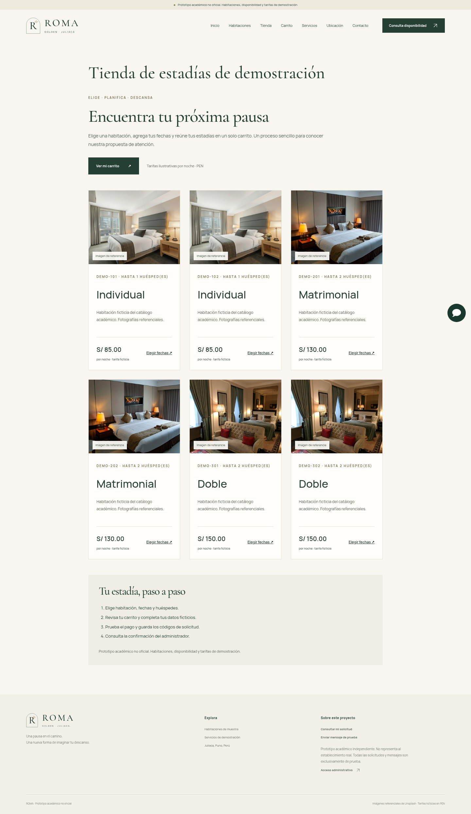

# Verificación del despliegue en AWS Academy

**Fecha:** 10/11/2026, hora de Perú. **Entorno:** AWS Academy Learner Lab, región us-east-1. **URL de demostración:** https://roma-demo.18-208-158-190.sslip.io/

El prototipo se instaló en una instancia EC2 `t3.medium`, Ubuntu Server 24.04 LTS x86_64, aproximadamente 4 GiB de RAM y volumen raíz de 30 GiB gp3. Se transfirió el código por SSH desde el repositorio local mediante un archivo de la revisión Git, sin copiar las credenciales de AWS, la llave SSH ni el `.env` local al código publicado. Las credenciales de las aplicaciones se generaron en el servidor y se conservan fuera de Git.

## Servicios y HTTPS

- Drupal, MariaDB, n8n y Mailpit iniciaron con comprobaciones de salud aprobadas.
- Caddy publica la web por HTTPS; la comprobación externa validó el certificado, sin desactivar TLS. HTTP redirige a HTTPS.
- La portada, `/tienda` y `/api/roma/v1/catalog` respondieron HTTP 200 desde fuera de EC2.
- Solo el proxy publica 80/443. Drupal directo, n8n y Mailpit enlazan a loopback; MariaDB solo está en la red Docker. Las conexiones externas a 8080, 5678, 8025 y 3306 no tuvieron acceso.
- Drupal reconoce únicamente la IP fija de Caddy como proxy de confianza. La sesión administrativa real presentó una cookie `Secure` y `HttpOnly`.
- Se configuró un propietario local de n8n, se comprobó el inicio de sesión y se verificaron los tres workflows ROMA en su cuenta. Su correo es ficticio y no ofrece recuperación por email; se puede cambiar desde el perfil.

## Pruebas ejecutadas en la instalación de EC2

| Grupo | Comprobaciones aprobadas | Evidencia |
| --- | ---: | --- |
| API pública y escritura autorizada | 15 | [Resultados del servidor](verificacion-aws-servidor.json) |
| Chat Drupal → n8n → Drupal | 13 | Mismo archivo; incluye consulta de datos y rechazo de origen/CSRF inválidos |
| Workflow de solicitud de reserva | 2 | Mismo archivo |
| Reglas de Drupal Commerce y transacciones | 18 | Mismo archivo; incluye integridad de importes y rollback |
| Navegador sobre HTTPS público | 38 | [Resultados de navegador](verificacion-aws-browser.json) |

Las 38 comprobaciones de navegador utilizaron el flujo real: catálogo, fechas, carrito de dos habitaciones, checkout, rechazo y cancelación de pago simulado, aprobación, recibo privado, ausencia de duplicados, aislamiento entre sesiones y revisión administrativa. Se confirmó y canceló el pedido de ensayo, sincronizándolo mediante el webhook real de n8n. Se evaluaron anchos de 1440, 768 y 390 píxeles. No se detectaron errores JavaScript.

Se reutilizó la prueba de navegador del repositorio con la URL pública y las operaciones de mantenimiento dirigidas a EC2 mediante SSH; se añadió la comprobación de cookie segura. Las credenciales temporales usadas por esa ejecución quedaron en un directorio local restringido fuera del repositorio. Las capturas y resultados publicados omiten las claves privadas de consulta.



## Entrar a las aplicaciones

La web y el panel Drupal usan el dominio HTTPS de arriba. El editor n8n permanece privado. Desde la computadora administradora, ejecuta en el repositorio:

```bash
sh scripts/aws-tunnel.sh 18.208.158.190 /ruta/local/roma-lab.pem
```

Mientras ese comando siga abierto, visita `http://localhost:15678` para n8n y `http://localhost:18025` para los correos ficticios. Las contraseñas se entregan en un archivo local con permisos 600 fuera del repositorio; no se incluyen en este documento.

## Límites de la demostración

El subdominio temporal usa el servicio DNS [sslip.io](https://sslip.io/), que resuelve nombres que contienen una IP y admite certificados individuales. No se compró un dominio ni se modificó el DNS del establecimiento. El servicio depende del laboratorio y de la instancia activa. Al detener y volver a iniciar EC2, la IP pública puede cambiar; en ese caso hay que actualizar el nombre temporal, la URL pública, los hosts permitidos, el proxy y el destino del túnel. No representa alojamiento permanente.

Los pagos siguen siendo simulados, sin cobros ni proveedor bancario externo. La aprobación de pago no confirma habitaciones. Las reservas, datos y tarifas son ficticios; las notificaciones se capturan en Mailpit y no se envían a clientes reales. No se habilitó OpenAI.

Los volúmenes Docker conservan datos entre recreaciones de contenedores. El respaldo inicial SQL es una copia restringida fuera de Git; no equivale a una estrategia completa de recuperación y no se ensayó su restauración en este despliegue. Para uso operativo deben respaldarse también los archivos Drupal, datos n8n y su clave de cifrado, además de probar la recuperación.

## Cambios que acompañan al despliegue

`compose.yaml` incorpora una red para Caddy y Drupal con direcciones fijas; `settings.php` recibe hosts y proxies de confianza desde el entorno. `scripts/aws-tunnel.sh` abre los puertos locales privados con SSH. Estos archivos, la guía y las evidencias pueden guardarse en Git; `.env`, llaves, contraseñas y respaldos se mantienen fuera.

## Textos de la experiencia de reserva

Se simplificaron los títulos de disponibilidad, contacto, tienda y carrito, junto con los botones «Solicitar reserva» y «Consultar disponibilidad». Los formularios presentan «Nombre completo», «Correo electrónico», «Teléfono» y «Datos del huésped»; los importes se muestran como estimados. La navegación usa «Habitaciones», «Servicios» y «Contacto». Se conservan el aviso del prototipo, la identificación de las tarifas e imágenes referenciales, el consentimiento y la explicación del pago simulado. Los cambios de presentación no habilitan cobros ni convierten el catálogo en una oferta oficial del establecimiento.

La comprobación sobre HTTPS, incluyendo formularios, carrito y checkout móvil, se registra en [los resultados de textos](verificacion-textos-aws.json). Para atender reservas del establecimiento se necesita su autorización y confirmar el inventario, las tarifas y el procedimiento de confirmación. Una pasarela real debe integrarse y verificarse antes de mostrar que un pago cobra dinero.
