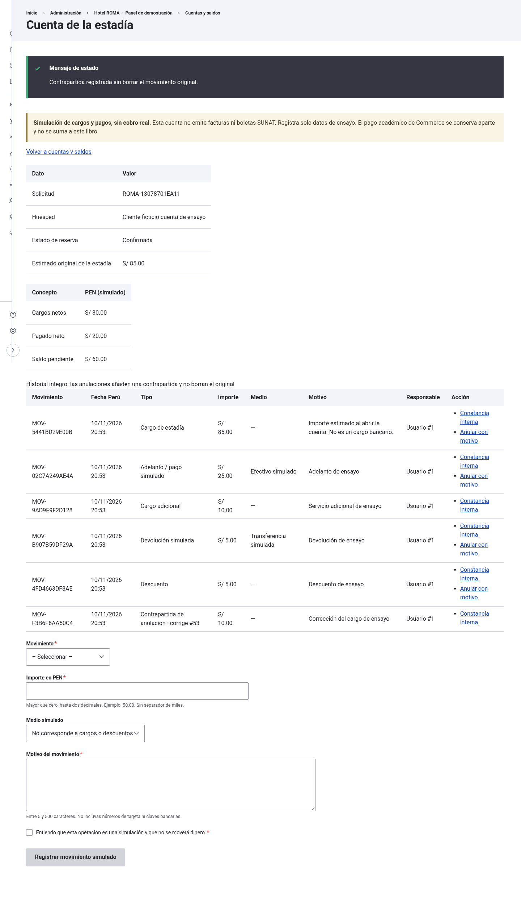

# Verificación de cuentas y saldos

Segunda ampliación funcional tras recepción. `roma_finance` incorpora un libro de movimientos en MariaDB con acceso exclusivo mediante permisos Drupal. No integra todavía una pasarela bancaria ni emisión SUNAT.

## Comportamiento implementado

- Cuenta por solicitud con cargo inicial basado en el estimado guardado. Consultar no crea registros y abrir nuevamente no duplica el cargo.
- Cargos, descuentos, adelantos/pagos y devoluciones, todos en modo `demo`. Céntimos enteros PEN, sin cálculos monetarios con coma flotante.
- Saldo = cargos netos − pagado neto. Los descuentos posteriores pueden producir saldo a favor; las devoluciones son operaciones explícitas.
- Historial que no se edita ni elimina desde la aplicación. Corregir agrega una contrapartida, vinculada de forma única al original, con motivo, usuario y hora.
- Rechazo de pagos sobre el saldo, devoluciones superiores al pagado, medios reales y anulaciones que dejarían netos negativos.
- Reserva confirmada requerida para pagos simulados; una cancelación no borra la cuenta ni devuelve automáticamente.
- Claves de idempotencia con huella del contenido y bloqueo InnoDB compartido con reservas. Un reenvío idéntico reutiliza el movimiento; reutilizar su clave con otros datos se rechaza.
- Reporte por fecha peruana, separando el flujo del periodo y los saldos actuales de las últimas 100 solicitudes.
- Constancias internas imprimibles identificadas como simulación sin validez tributaria; no se genera una factura o boleta.
- Avisos financieros encolados en la misma transacción y entregados por el workflow n8n existente solo al administrador ficticio en Mailpit.

Los pagos académicos de Commerce no se importan como ingresos del libro. Registrar otra simulación sirve para ensayar adelantos; no verifica ni reproduce un cobro bancario.

## Pruebas en AWS

La ejecución final aprobó **103 comprobaciones de servidor**:

| Grupo | Aprobadas |
| --- | ---: |
| Reglas financieras y cola de avisos | 40 |
| Carreras reales de pagos, anulaciones e idempotencia | 3 |
| Workflow n8n y recepción SMTP Mailpit | 3 |
| Regresión API | 15 |
| Regresión chatbot n8n | 13 |
| Regresión recepción | 29 |

[Evidencia del servidor](verificacion-finanzas-servidor.json). Las reglas se ensayaron con transacciones revertidas. Las pruebas de concurrencia y avisos retiraron sus propias reservas y cuentas. Mailpit conserva mensajes ficticios de ensayo; no se envían a Internet.

La prueba de navegador verifica acceso anónimo rechazado, usuario autenticado sin permiso rechazado, administración, apertura protegida por CSRF, adelanto, cargo, descuento, devolución, contrapartida, constancia, impresión, reporte y uso a 390 píxeles. [Evidencia del navegador](verificacion-finanzas-browser.json).



Durante la validación se normalizaron explícitamente identificadores e importes leídos por PDO para mantener el mismo contrato de tipos al crear un movimiento y al recuperarlo por idempotencia. También se comprobó que los scripts temporales se copien al contenedor después de recrearlo. La lectura de cuentas consulta primero si existe la apertura, evitando presentar como abierta una cuenta sin su cargo inicial durante una apertura concurrente.

## Instalar en una base existente

```bash
docker compose build drupal
docker compose stop drupal
docker compose run --rm --no-deps --entrypoint vendor/bin/drush install en roma_finance --yes
docker compose up -d --wait drupal
docker compose exec -T drupal vendor/bin/drush cache:rebuild
```

El instalador general lo habilita también en instalaciones nuevas. Se añaden las tablas `roma_finance_account` y `roma_finance_entry`; no se reemplazan los datos hoteleros. El rol responsable hotelero recibe `manage roma finance`; los roles públicos no lo reciben.

## Repetir comprobaciones

```bash
docker compose cp tests/finance.php drupal:/tmp/roma-finance.php
docker compose exec -T drupal vendor/bin/drush php:script /tmp/roma-finance.php
python3 tests/finance-concurrency.py
python3 tests/finance-notifications.py
deno run --cached-only --allow-all tests/finance-browser.mjs
```

La prueba de navegador usa el mismo entorno Deno, Puppeteer y Brave de las pruebas previas. `ROMA_BROWSER_BASE` permite cambiar la URL; la CLI Docker y el `.env` de pruebas deben corresponder a esa misma instalación. En AWS se dirigieron esas operaciones mediante SSH, guardando los secretos fuera de Git.

## Límites y siguiente fase

No hay cobros reales, conciliación bancaria ni comprobantes electrónicos. Las constancias internas no son documentos tributarios. Los avisos SMTP se omiten después de una entrega registrada; un fallo entre aceptación SMTP y guardado puede repetir un correo, identificable mediante `X-ROMA-Event`. Esto no duplica el movimiento del libro.

La siguiente fase es facturación en el servicio beta de SUNAT, con biblioteca PHP evaluada, XML UBL firmado, correlativos y respuestas CDR auditables. La fecha de emisión, tratamiento de anticipos e impuestos deben configurarse para el contribuyente antes de una puesta en producción. No debe inferirse que una solicitud o pago simulado obliga a emitir un comprobante real.
